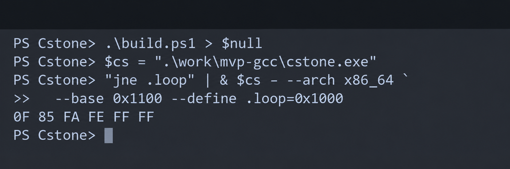

# Cstone

A standalone C11 assembler library that turns assembly text into machine code, labels, and relocations. Cstone includes a C API and a command-line tool, with no LLVM, Keystone, or other third-party runtime dependencies in its core.

[](https://github.com/Jeanorochka/cstone/actions/workflows/ci.yml)
[](LICENSE)

**Version 0.2.0 is an MVP with a documented instruction subset.** Architecture support does not imply complete ISA coverage. See the [instruction reference](docs/support.md) before choosing a target.

## Target architectures

| Family | CLI profiles | Scope |
| --- | --- | --- |
| x86 | `x86`, `x86_64` | Intel syntax, integer instructions, memory operands, branches |
| Arm | `arm`, `thumb`, `aarch64` | ARMv7 ARM/Thumb and AArch64 integer subsets |
| RISC-V | `riscv32`, `riscv64` | Integer instructions and selected M/Zicsr/Zifencei forms |
| MIPS | `mips32le`, `mips32be`, `mips64le`, `mips64be` | Selected MIPS32r2/MIPS64r2 instructions in both byte orders |

Every library build includes all 11 target profiles. The host CPU does not restrict which target you can assemble.

## Quick start on Windows

Run these commands in PowerShell. The default build uses GCC/MinGW, CMake, and Ninja. The script can also find Ninja in an installed Visual Studio.

```powershell
git clone https://github.com/Jeanorochka/cstone.git
cd cstone
.\build.ps1
$cs = ".\work\mvp-gcc\cstone.exe"
"jne .loop" | & $cs - --arch x86_64 `
  --base 0x1100 --define .loop=0x1000
```

Output:

```text
0F 85 FA FE FF FF
```

This assembles a conditional jump at address `0x1100` to an external symbol at `0x1000`.

Other build configurations:

```powershell
.\build.ps1 -Compiler msvc
.\build.ps1 -Compiler clang
.\build.ps1 -Compiler gcc -Shared
.\build.ps1 -Compiler msvc -Shared
```

MSVC requires Visual Studio with the C++ tools. The GNU-targeting Clang configuration also requires MinGW headers and libraries. Build files and test artifacts stay in `work/`.

## Build with CMake

Requires a C11 compiler and CMake 3.20 or newer. Python 3.10 or newer enables the CLI integration tests and is required by the release packaging gate.

```sh
git clone https://github.com/Jeanorochka/cstone.git
cd cstone
cmake -S . -B work/build -DCMAKE_BUILD_TYPE=Release
cmake --build work/build --config Release --parallel
ctest --test-dir work/build -C Release --output-on-failure
cmake --install work/build --prefix work/install --config Release
```

Add `-DBUILD_SHARED_LIBS=ON` for a DLL, shared object, or dynamic library. The installation includes the public header, library, CLI, CMake package, pkg-config file, and documentation.

On a Unix shell, the same jump example is:

```sh
printf 'jne .loop\n' | ./work/build/cstone - --arch x86_64 \
  --base 0x1100 --define .loop=0x1000
```

## C API

```c
#include "cstone.h"
#include <stdio.h>

int main(void) {
    cstone_options options;
    cstone_result result;
    cstone_options_init(&options);
    options.arch = CSTONE_X86_64;
    options.base_address = 0x1000;

    cstone_status status =
        cstone_assemble_ex("mov eax,42\nret", &options, &result);

    if (status == CSTONE_OK) {
        for (size_t i = 0; i < result.size; ++i)
            printf("%02X%s", (unsigned)result.bytes[i],
                   i + 1 == result.size ? "\n" : " ");
    } else {
        fprintf(stderr, "%s\n", result.diagnostic.message);
    }

    cstone_result_free(&result);
    return status == CSTONE_OK ? 0 : 1;
}
```

Output: `B8 2A 00 00 00 C3`.

Use `cstone_assemble_n` for a buffer with an explicit length. Set `CSTONE_ALLOW_UNRESOLVED` to export external relocations, then resolve them with `cstone_link`. Failed linking leaves the original bytes unchanged. Independent calls do not share mutable state.

Read the [API and ownership contract](docs/api.md) for limits, diagnostics, ABI details, and relocation handling.

To use an installed library from CMake:

```cmake
find_package(Cstone 0.2 REQUIRED CONFIG)
target_link_libraries(your_target PRIVATE Cstone::cstone)
```

Pass the install prefix through `CMAKE_PREFIX_PATH`. Working C and C++ consumer projects are in [tests/consumer](tests/consumer).

## Command line

```text
cstone --list-arch
cstone --arch aarch64 example.asm --base 0x1000 --json
cstone example.asm -o example.bin
cstone example.asm --define helper=0x2000 --base 0x1000
```

- `-` reads assembly from stdin.
- `-o -` writes raw binary bytes; the default output is hexadecimal text.
- `--labels` prints labels to stderr.
- `--allow-unresolved --json` exports unresolved references with their relocation metadata.
- `--define NAME=ADDRESS` binds an external symbol.
- Windows filenames support Unicode.

The CLI refuses raw output with unresolved references. Exit codes are `0` for success, `1` for assembly or I/O errors, and `2` for invalid command-line arguments.

## Validation

The test suite covers known encodings, numeric boundaries, resource limits, allocation failures, rollback, malformed input, threading, and CLI behavior.

The local validation baseline includes:

- Windows builds with GCC, Clang, and MSVC; Linux builds with GCC.
- Static and shared packages, clean source builds, and installed C/C++ consumers.
- 100,000 deterministic input mutations and 8,000 assemblies across eight threads.
- 78,195 bytes compared with independent Clang/LLD or Keystone output.
- 1,029 execution scenarios through Unicorn across nine profiles.
- Windows AddressSanitizer and Linux AddressSanitizer/UBSan checks.

MIPS64 encodings are compared independently; MIPS64 execution is not covered. The [CI workflow](.github/workflows/ci.yml) also defines Windows, Linux, and macOS builds. Current remote results are available in [Actions](https://github.com/Jeanorochka/cstone/actions).

Optional development checks require Clang, LLD, objcopy, and the pinned Python packages below. These tools are not linked into Cstone.

```sh
python -m pip install -r tests/requirements.txt
python tests/differential.py --cstone work/build/cstone
python tests/architectures.py --cstone work/build/cstone
python tests/emulation.py --cstone work/build/cstone
```

Unix builds can enable `CSTONE_SANITIZERS` or `CSTONE_FUZZ`. Windows MSVC supports `.uild.ps1 -Compiler msvc -AddressSanitizer -Configuration RelWithDebInfo`.

## Scope and releases

Cstone produces raw machine code. It does not disassemble or execute code, write ELF/COFF objects, perform automatic branch relaxation, or provide complete instruction sets. Macro processing, a general expression language, SIMD/floating-point coverage, and language bindings are outside this MVP.

See the [exact supported forms](docs/support.md), [release checklist](docs/release.md), [changelog](CHANGELOG.md), and [security policy](SECURITY.md). The packaging script runs the release test gate, checks the installed CLI, and writes archives and SHA-256 checksums to `dist/`.

## License

[MIT](LICENSE).
